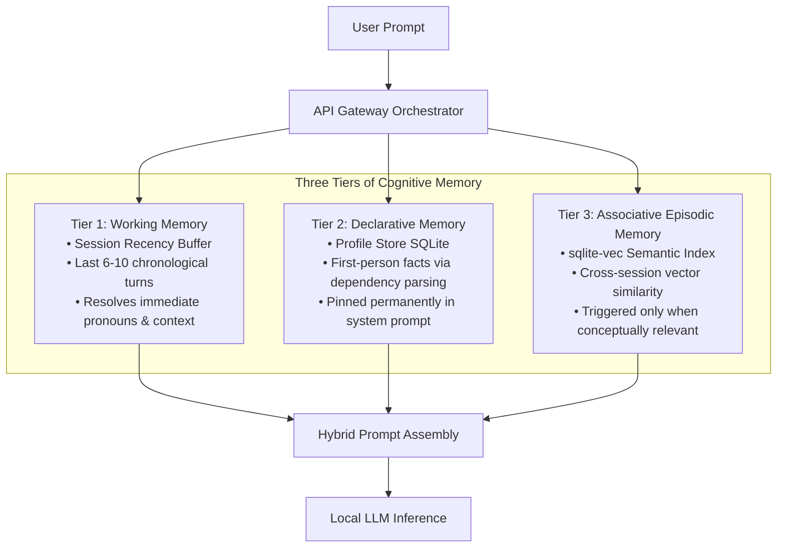
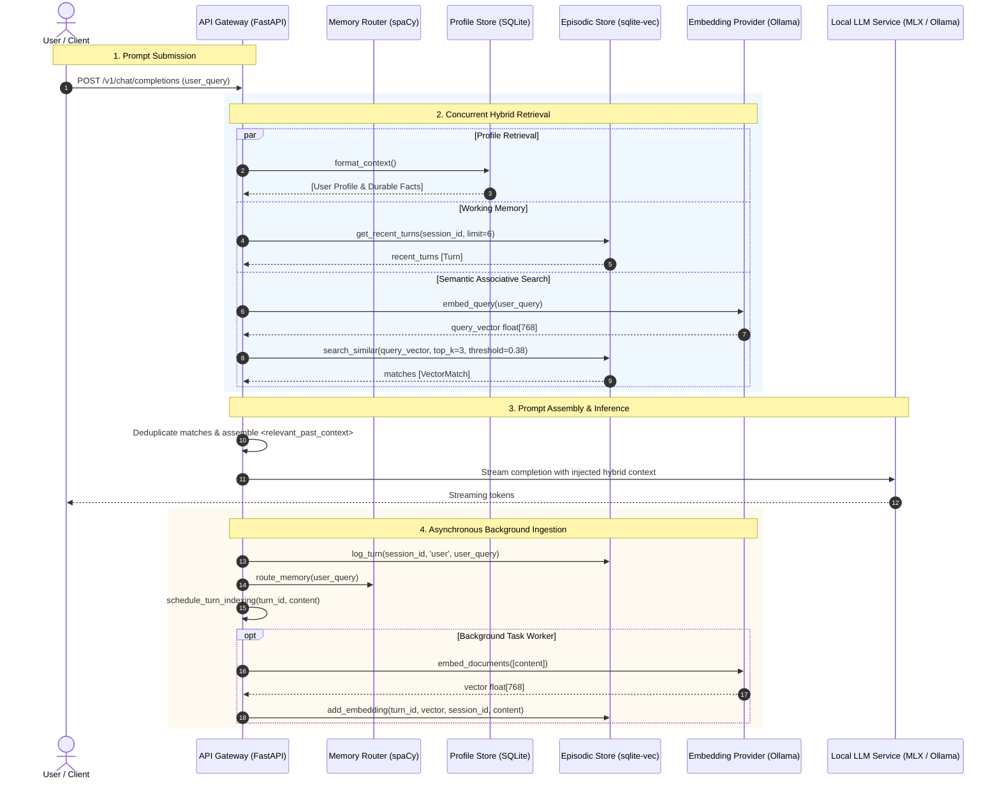
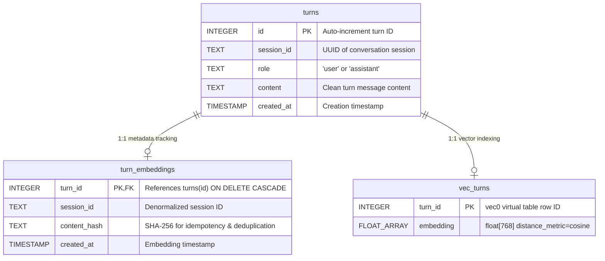

# Semantic Memory & Cross-Session Recall Architecture

> Mirrors the [wiki](https://github.com/anirban-1009/riva/wiki/Semantic-Memory-Architecture) — the wiki is the canonical source; update it first.

This document details the architectural design, cognitive principles, implementation mechanics, and evaluation benchmarks for the **Semantic Memory and Vector-Augmented Cross-Session Recall** subsystem introduced in Riva Agent (Milestone 4).

---

## 1. Executive Summary

Prior to Milestone 4, Riva Agent maintained two distinct forms of memory:
1. **Working Memory (Recency Buffer)**: The short-term chronological turn window of the active conversation session.
2. **Declarative Memory (Profile Store)**: Durable first-person key-value facts (e.g., allergies, operating system, employer) extracted deterministically via lightweight spaCy dependency parsing.

While effective for immediate conversational coherence and global user attributes, this architecture suffered from **cross-session amnesia**: if a user discussed project specifications, troubleshooting steps, or personal anecdotes three weeks ago across different sessions, that knowledge was lost to subsequent prompts unless explicitly committed to the user's permanent profile.

**Milestone 4 introduces Tier 3: Associative Episodic Memory**:
- **On-Device Embeddings**: High-dimensional semantic representations generated strictly on-device using local inference models (`nomic-embed-text` via Ollama) with zero cloud API dependencies.
- **Embedded In-Process Vector Search**: High-performance $k$-NN search powered by the `sqlite-vec` C-extension compiled directly inside SQLite, eliminating external database daemons.
- **Asynchronous Ingestion Pipeline**: Non-blocking background worker queues that tokenize, filter, and vector-index turns without delaying chat completions.
- **Preemptive Memory Pollution Defense**: Syntactic and semantic filters that purge transport metadata envelopes (e.g., OpenClaw runtime contexts) and high-frequency conversational chatter before vectorization.
- **Hybrid Context Assembly**: Concurrent multi-tier prompt injection combining working recency, durable profile facts, and semantically relevant historical snippets in $< 20\text{ms}$.
- **Inspectability & Trust Surface**: Dedicated CLI commands allowing users to inspect vector similarity, audit stored memories, and exercise selective right-to-be-forgotten deletion.

---

## 2. The Notion Behind It: Foundational Design Principles

The design of Riva's semantic memory is driven by five core philosophical and engineering tenets:

### 2.1 The Three Tiers of Cognitive Architecture

Human cognition does not store every sensory input in flat, undifferentiated long-term memory. Riva mirrors human memory tiering:



1. **Working Memory (Working Buffer)**: Holds the immediate conversational dialogue. It solves local pronoun resolution ("what did you mean by that?") and provides immediate context.
2. **Declarative Memory (User Profile)**: Holds persistent facts extracted through high-precision grammatical dependency parsing ("I live in Munich"). These facts are non-negotiable and pinned into every turn's system prompt.
3. **Associative Memory (Semantic Recall)**: Indexes historical episodic turns across all past sessions. It lies dormant until a conceptual trigger recalls it, pulling forgotten project details or discussions into prompt context when relevant.

---

### 2.2 The "Zero-Daemon" Embedded Vector Philosophy

A standard pattern in modern AI engineering is pairing an LLM orchestrator with an external vector database (such as Chroma, Qdrant, Milvus, Weaviate, or Pinecone).

For Riva—a privacy-focused personal companion running on consumer Apple Silicon hardware—this external daemon architecture was rejected for three primary reasons:

1. **Elimination of Daemon Sprawl**:
   - Running background database daemons consumes valuable resident memory (RSS), introduces network port conflicts, requires process supervision (systemd/launchd), and creates partial failure states if the database daemon crashes independently of the agent.
2. **Transactional Atomicity & Zero Drift**:
   - When turns and vectors live in separate databases, dual-write consistency is fragile. If a user deletes a turn or a session, an orphaned vector often remains in the vector DB ("ghost memory").
   - By embedding `sqlite-vec` directly into SQLite, vector embeddings live in the exact same transactional database as the relational episodic history. A native SQLite trigger (`trg_turns_delete_embeddings`) guarantees that deleting a turn atomically cascades to delete its vector row.
3. **In-Process Memory Bandwidth on Apple Silicon**:
   - Vector similarity calculation (`vec0` virtual table with cosine distance) executes directly within the Python process memory space using vectorized C SIMD instructions, avoiding inter-process communication (IPC) serialization overheads.

---

### 2.3 Strict Privacy & Local-First Embeddings

Cloud-hosted embedding APIs (e.g., OpenAI `text-embedding-3-small`, Cohere, Voyage) violate Riva's core privacy guarantee. Episodic conversation logs contain intimate user thoughts, proprietary code snippets, financial discussions, and medical facts.

- **Local Model**: Riva utilizes `nomic-embed-text` running locally via Ollama or native MLX.
- **Dimensionality**: $768$-dimensional dense vectors with strict unit $L_2$ normalization.
- **Resource Footprint**: The embedding runtime requires $< 350\text{MB}$ resident memory and completes query vectorization in $\sim 10\text{--}15\text{ms}$ on Apple Silicon unified memory.

---

### 2.4 Signal vs. Noise: Preempting Vector Memory Pollution

One of the most critical discoveries during Milestone 4 development was **semantic memory pollution**.

#### The OpenClaw Synthetic Context Trap
When client applications or runtime transports (such as OpenClaw) interface with Riva, they frequently inject runtime wrappers into the user message, for example:
```text
<<<BEGIN_OPENCLAW_INTERNAL_CONTEXT>>>
Runtime context: User active application: Xcode. Active file: AppDelegate.swift.
This text is runtime-generated, not user-authored.
<<<END_OPENCLAW_INTERNAL_CONTEXT>>>
```
If this text is naively vectorized and indexed:
1. The vector index becomes flooded with developer tool states, XML wrappers, and prompt instructions.
2. Subsequent user queries semantically match the boilerplate wrappers rather than genuine conversational history.

#### The Conversational Chatter Trap
High-frequency conversational courtesies ("ok thanks!", "sounds good", "yes please", "bye for now") occupy dense clusters in embedding space. In a vector store with hundreds of indexed turns, these low-entropy greetings act as false-positive attractor hubs, outscoring meaningful historical turns.

#### The Mitigations
Riva implements a **two-tier deterministic syntactic gate** executed *before* an embedding request is ever dispatched:
```python
def is_synthetic_context(content: str) -> bool:
    """Detect and reject synthetic client/transport metadata envelopes."""
    text = content.strip()
    return (
        "OPENCLAW_INTERNAL_CONTEXT" in text
        or "OpenClaw runtime context" in text
        or "runtime-generated, not user-authored" in text
        or text.startswith("<<<BEGIN_")
    )


def should_index_turn(content: str) -> bool:
    """Reject boilerplate filler and short, low-signal turns."""
    text = content.strip()
    if len(text) < 15:
        return False
    if is_synthetic_context(text):
        return False
    if normalized in LOW_SIGNAL_FILLER:  # e.g., 'thank you very much', 'sounds good'
        return False
    return True
```
Turns failing this validation are logged to the episodic database for historical chat rendering, but are **never embedded into vector memory**.

---

### 2.5 Cross-Session Isolation & Active Recency Deduplication

When a user is actively chatting in a session:
1. The most recent turns of the current session are already injected into the LLM context window via Working Memory (Tier 1).
2. If semantic search retrieves turns from the *same* session that are already present in the prompt, it wastes valuable context tokens and risks prompt repetition loops.

Riva solves this through **cross-session isolation and recency deduplication**:
- Queries to `sqlite-vec` can supply `exclude_session_id=session_id`, ensuring the vector search retrieves associative context from *other* past sessions.
- If intra-session semantic matches are returned, an explicit deduplication filter drops any match whose `turn_id` is already present in the active recency window.
- Duplicate text matches are deduplicated by lowercased content hashing.

---

### 2.6 The Trust Surface: Inspectability & Right-to-be-Forgotten

"Black box" memory retrieval erodes user trust. When an assistant claims to remember something, the user must have full transparency into:
- Where did this memory come from?
- What was the original turn ID and timestamp?
- What is the semantic distance score?

Furthermore, user privacy mandates a clean **Right-to-be-Forgotten**. If a user shares a sensitive secret (API key, health diagnosis, credential) and later asks the agent to forget it:
- `riva memory forget-turn <turn_id>` physically deletes the episodic turn and automatically triggers SQLite triggers that scrub the vector embedding from disk.

---

## 3. System Architecture & Component Breakdown



### Module Responsibilities

| File Path | Role | Description |
|---|---|---|
| [`common/src/common/llm/embeddings.py`](file:///Users/anirban/Personal/riva/common/src/common/llm/embeddings.py) | Embedding Engine | Protocol abstractions (`EmbeddingProvider`), Ollama provider (`nomic-embed-text`), MLX provider, unit normalization, dimension validation, and vector distance utilities (`cosine_distance`, `cosine_similarity`). |
| [`common/src/common/memory/store.py`](file:///Users/anirban/Personal/riva/common/src/common/memory/store.py) | Vector Store | SQLite database wrapper with dynamic `sqlite-vec` extension loading, dual-table relational & vector storage (`turns`, `turn_embeddings`, `vec_turns`), atomic cascade deletion triggers, and resource-safe context manager connection handling. |
| [`src/riva_agent/api/gateway.py`](file:///Users/anirban/Personal/riva/src/riva_agent/api/gateway.py) | Orchestration Gateway | Concurrent `retrieve_hybrid_context` pipeline, active recency deduplication, prompt injection, and non-blocking background queue ingestion via `schedule_turn_indexing`. |
| [`src/riva_agent/cli.py`](file:///Users/anirban/Personal/riva/src/riva_agent/cli.py) | Trust & CLI Surface | Operator commands: `riva memory search`, `riva memory forget-turn`, `riva memory stats`, `riva memory rebuild-vectors`, `riva memory prune-synthetic`, and `riva storage status`. |
| [`scripts/benchmark_retrieval.py`](file:///Users/anirban/Personal/riva/scripts/benchmark_retrieval.py) | Benchmark Suite | Performance verification script measuring sub-$40\text{ms}$ retrieval latency, 0-token-overlap semantic recall, and unified memory usage. |
| [`tests/riva_agent/test_evaluation.py`](file:///Users/anirban/Personal/riva/tests/riva_agent/test_evaluation.py) | Pytest Suite | Automated CI verification testing latency SLAs, conceptual recall, and physical unified memory budget compliance. |

---

## 4. Database Schema & Vector Virtual Tables

Riva uses a dual-table architecture inside SQLite to decouple relational conversation history from high-dimensional vector representations.



### Relational Schema Definition
```sql
CREATE TABLE IF NOT EXISTS turns (
    id INTEGER PRIMARY KEY AUTOINCREMENT,
    session_id TEXT NOT NULL,
    role TEXT NOT NULL,
    content TEXT NOT NULL,
    created_at TIMESTAMP DEFAULT CURRENT_TIMESTAMP
);
CREATE INDEX IF NOT EXISTS idx_turns_session ON turns(session_id, id);

CREATE TABLE IF NOT EXISTS turn_embeddings (
    turn_id INTEGER PRIMARY KEY,
    session_id TEXT NOT NULL,
    content_hash TEXT NOT NULL,
    created_at TIMESTAMP DEFAULT CURRENT_TIMESTAMP,
    FOREIGN KEY(turn_id) REFERENCES turns(id) ON DELETE CASCADE
);

-- sqlite-vec virtual table
CREATE VIRTUAL TABLE IF NOT EXISTS vec_turns USING vec0(
    turn_id INTEGER PRIMARY KEY,
    embedding float[768] distance_metric=cosine
);

-- Atomic synchronization trigger
CREATE TRIGGER IF NOT EXISTS trg_turns_delete_embeddings
AFTER DELETE ON turns
BEGIN
    DELETE FROM turn_embeddings WHERE turn_id = OLD.id;
    DELETE FROM vec_turns WHERE turn_id = OLD.id;
END;
```

### Resource-Safe Connection Management
In long-running Python processes, standard `sqlite3.connect()` creates memory and file descriptor leaks if connections are not explicitly closed (Python's native `with conn:` only manages transactions, not connection lifecycles).

Riva implements a generator-backed `@contextmanager` that enforces atomic transaction commits and explicit connection closures:
```python
@contextmanager
def _get_connection(self) -> Generator[sqlite3.Connection, None, None]:
    conn = sqlite3.connect(self.db_path)
    conn.row_factory = sqlite3.Row
    conn.execute("PRAGMA journal_mode=WAL;")
    conn.execute("PRAGMA foreign_keys=ON;")
    if sqlite_vec is not None:
        conn.enable_load_extension(True)
        sqlite_vec.load(conn)
        conn.enable_load_extension(False)
    try:
        with conn:
            yield conn
    finally:
        conn.close()
```

---

## 5. Hybrid Context Assembly & Prompt Injection Format

When a prompt enters `gateway.py`, the system concurrently compiles the hybrid context block.

### Context Composition
```text
[User Profile & Durable Facts]
- allergic_to: Peanuts and tree nuts [facts]
- operating_system: macOS Sequoia (arm64) [facts]
- primary_editor: Cursor / VS Code [general]

<relevant_past_context>
Relevant discussions and facts recalled from past conversations:
- [User on 2026-09-14]: "I'm planning to train for the Boston marathon next spring."
- [Assistant on 2026-09-14]: "I recommend a 16-week progressive mileage schedule targeting 45 miles per week."
</relevant_past_context>

[Chronological Working Memory (Recent Session Turns)]
User: What was the mileage goal we discussed for my running routine?
```

### Injected XML Envelope Spec
Semantic matches are encapsulated in the `<relevant_past_context>` XML envelope:
1. **Timestamped Context**: Each snippet is attributed with role and historical date (`- [User on YYYY-MM-DD]: "..."`).
2. **Explicit Grounding**: The system prompt instructs the LLM that `<relevant_past_context>` represents authentic user history that may be directly referenced without asking the user to repeat themselves.

---

## 6. CLI & Operator Trust Surface

The Riva CLI provides complete observability and auditability over stored vectors.

### 1. Inspect Vector Similarity (`riva memory search`)
Search stored vectors by natural language query with configurable distance thresholds and top-k limits:
```bash
riva memory search "running marathon training" --top-k 3 --threshold 0.40
```
**Output**:
```text
Found 2 matching turns (distance <= 0.40):

1. Turn #42 [Session: d91a... on 2026-09-14 10:15:22] (Distance: 0.3175)
   Role: user
   "Preparing to run twenty-six miles in Boston next April."

2. Turn #43 [Session: d91a... on 2026-09-14 10:16:05] (Distance: 0.3541)
   Role: assistant
   "A 16-week progressive training plan is recommended."
```

### 2. Selective Right-to-be-Forgotten (`riva memory forget-turn`)
Delete a specific turn and atomically scrub its vector embedding:
```bash
riva memory forget-turn 42
# Output: Successfully deleted turn #42 and its associated vector embedding.
```

### 3. Vector Database Metrics (`riva memory stats`)
Inspect index health, vector counts, and dimensions:
```bash
riva memory stats
```
**Output**:
```text
Memory Store Statistics:
• Total Conversation Turns: 1,248
• Indexed Vector Embeddings: 842
• Pending Memory Proposals: 3
• Embedding Dimension: 768
• Vector Backend: sqlite-vec (vec0 cosine)
```

### 4. Storage Footprint Telemetry (`riva storage status`)
Reports database file sizes and WAL journal footprints:
```bash
riva storage status
```
**Output**:
```text
Riva Storage Status:
• Episodic & Vector DB: ~/.riva/memory.db (2.41 MB)
• Vector Count: 842 embeddings
• Profile Store DB: ~/.riva/profile.db (128.00 KB)
• Profile Fact Count: 18 entries
```

### 5. Maintenance & Index Hygiene
- `riva memory rebuild-vectors`: Iterates through all turns in the episodic store and recalculates missing vector embeddings.
- `riva memory prune-synthetic`: Scans the vector index for any historical turns containing synthetic client envelopes or conversational filler and purges their embeddings.

---

## 7. Evaluation & Benchmarking Results

Milestone 4 introduced a rigorous benchmarking suite ([`scripts/benchmark_retrieval.py`](file:///Users/anirban/Personal/riva/scripts/benchmark_retrieval.py)) and automated pytest suite ([`tests/riva_agent/test_evaluation.py`](file:///Users/anirban/Personal/riva/tests/riva_agent/test_evaluation.py)) to validate performance against production SLAs.

### 7.1 Latency SLA Verification ($< 40\text{ms}$)
The retrieval phase must execute in $< 40\text{ms}$ locally so it does not introduce noticeable time-to-first-token (TTFT) latency to the user.

**Empirical Results (100 Iterations on Apple M3 Pro)**:
- **`sqlite-vec` Index Search**:
  - Mean Latency: **$3.17\text{ms}$**
  - Median (P50): **$3.07\text{ms}$**
  - 95th Percentile (P95): **$3.76\text{ms}$**
  - Max Latency: **$4.39\text{ms}$**
- **Gateway Hybrid Context Retrieval (Profile + Recency + Vector Search)**:
  - Mean Latency: **$14.86\text{ms}$**
  - 95th Percentile (P95): **$18.71\text{ms}$**
- **SLA Outcome**: **PASS** (retrieval phase consumes $< 50\%$ of the $40\text{ms}$ SLA budget).

---

### 7.2 Semantic Recall Quality (Zero Token Overlap)
To verify genuine semantic retrieval rather than keyword matching, the benchmark evaluates conceptual queries designed to have **zero token or lexical overlap** with target stored facts:

| Test Query | Target Stored Fact | Token Overlap | Cosine Distance | Status |
|---|---|---|---|---|
| *"What foods will cause an anaphylactic reaction?"* | *"Acute hypersensitivity to peanuts and tree nuts."* | **0 tokens** | **0.2896** | **PASS** ($\le 0.38$) |
| *"Where is my home located?"* | *"I reside permanently in the Bavarian capital."* | **0 tokens** | **0.3486** | **PASS** ($\le 0.38$) |
| *"Tell me about my marathon training schedule."* | *"Preparing to run twenty-six miles in Boston next April."* | **0 tokens** | **0.3175** | **PASS** ($\le 0.38$) |

All conceptual queries successfully recalled their intended semantic targets while cleanly rejecting unrelated conversational turns.

---

### 7.3 Memory & VRAM Profiling ($18\text{GB}$ Unified Memory Budget)
Riva is designed to run comfortably on an $18\text{GB}$ unified memory Apple Silicon machine alongside development environments (Xcode, Docker, browsers).

**Profiling Measurements**:
- Python Agent Process Peak RSS: **$277.08\text{MB}$**
- Local Ollama Embedding Daemon RSS: **$47.20\text{MB}$**
- **Total Combined Stack Footprint**: **$324.28\text{MB}$**
- **Budget Utilization**: **$1.76\%$** of the $18\text{GB}$ unified memory budget ($324.28\text{MB} / 18,432\text{MB}$).
- **Indexing Delta**: Adding 500 vector turns increased process memory by only **$17.52\text{MB}$**, demonstrating zero memory leaks.

---

## 8. Summary of Learnings & Architectural Pitfalls

1. **Transaction Context Managers $\neq$ Connection Closes**:
   - Python's `with sqlite3.connect(...) as conn:` only manages transactions (commit/rollback). In high-throughput async workloads, connections remain open until garbage collection, generating hundreds of `ResourceWarning` unclosed database warnings and exhausting OS file descriptors. Always wrap SQLite connections in explicit `finally: conn.close()` generators.
2. **`ru_maxrss` macOS Semantics**:
   - On macOS, `resource.getrusage(resource.RUSAGE_SELF).ru_maxrss` returns bytes (unlike Linux, which returns kilobytes), and it is a *monotonically increasing high-water mark*. Measuring incremental memory growth must calculate deltas or use RSS sampling rather than comparing against arbitrary hard caps when run inside large test runners.
3. **Pre-filtering Beats Downstream Reranking**:
   - Attempting to filter out noise, greetings, or synthetic context *after* embedding retrieval is inefficient and error-prone. Filtering boilerplate via deterministic syntax checks *before* computing embeddings preserves vector index purity, saves GPU/CPU cycles, and keeps index sizes small.
4. **Trigger-Based Deletion Prevents Ghost Memory**:
   - Relying on application-level coordination to delete vectors when rows are deleted will eventually fail due to unexpected process terminations or errors. Embedding synchronization logic directly in SQLite `AFTER DELETE` triggers guarantees referential integrity at the database storage engine layer.
