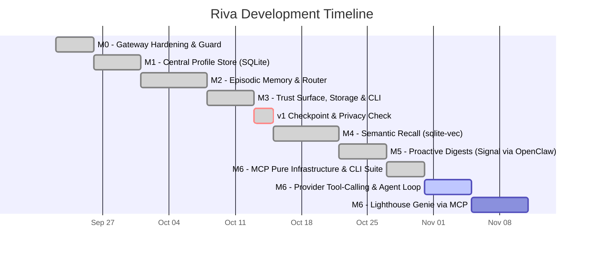

# Riva Agent: Development Timeline & Roadmap

> Mirrors the [wiki](https://github.com/anirban-1009/riva/wiki/Development-Timeline) — the wiki is the canonical source; update it first.

Based on the canonical specifications in the [Product Definition](https://github.com/anirban-1009/riva/wiki/Product-Definition) and [Architecture](../architecture/architecture.md), this document outlines a phased development timeline to deliver Riva as a private, persistent personal assistant.

---

## Roadmap Overview & Milestones

---

## Milestone Breakdown & Target Timelines

### Phase 1: Foundation & Gateway Hardening (M0)
**Status**: **COMPLETED** (Verified via test suite & OpenClaw live testing)
**Estimated Duration**: ~3–4 Days
**Primary Focus**: Lock in streaming reliability, privacy constraints, and dual-mode routing.

- **Dual-Mode Gateway Routing (§5 of Product Definition)**:
  - `model: "riva"` activates Assistant mode (prompt assembly, memory injection).
  - Any concrete model (e.g. `gemma4:12b-mlx`, `llama3:8b`) remains **Pass-through mode** (byte-for-byte proxy, 0ms overhead, no memory reads/writes, ensuring OpenClaw stays unaffected).
- **Streaming Contract Tests**:
  - Verify initial SSE role chunk (`delta.role: "assistant"`).
  - Test keep-alive heartbeat polling via `asyncio.wait` during model prefill.
- **Privacy Hardening**:
  - Explicitly guard the `openai` provider in `config.yml` as evaluation/benchmarking-only with runtime warnings.
- **Exit Criteria**:
  - All existing coding tools (OpenClaw) continue to work with identical latency and zero prompt pollution.

---

### Phase 2: The User Profile System (M1)
**Status**: **COMPLETED** (Implemented in `common/profile/store.py` with 100% test coverage)
**Estimated Duration**: ~4–5 Days
**Primary Focus**: A persistent, structured model of the user that survives restarts.

- **Local Storage Engine**:
  - SQLite database at `~/.riva/profile.db` (zero network surface, inspectable via `sqlite3` CLI).
- **Schema & Data Models**:
  - Goals (career, fitness, learning, finance).
  - Constraints (dietary, time, hardware, financial).
  - Preferences (communication style, stack, conventions).
  - Explicit durable facts.
- **Profile Operations & Tooling**:
  - Programmatic read/write API under `common/profile/`.
  - Human-friendly export/import (YAML/Markdown) for direct manual editing.
  - Prompt context formatter (generates a concise system prompt injection).
- **Exit Criteria**:
  - Profile persists across restarts; manually editable in text; formats cleanly into LLM prompts within token budget.

---

### Phase 3: Episodic Memory & Syntactic Admission Router (M2)
**Status**: **COMPLETED** (Implemented in `common/memory/store.py` & `src/riva_agent/intelligence/memory_router.py`)
**Estimated Duration**: ~6–7 Days
**Primary Focus**: Conversation recording, recency retrieval, and deterministic fact admission.

- **Episodic Conversation Store & Retention Primitives**:
  - Chronological session and turn logging in SQLite (`~/.riva/memory.db`).
  - Recency-based windowing (retrieving the most recent $N$ conversational turns).
  - Storage retention primitives: programmatic API for turn pruning by age (`prune_turns(older_than_days)`) and automatic 7-day expiration of unreviewed pending memories per §6 (`expire_pending(max_age_days=7)`).
  - SQLite WAL mode configuration and connection hygiene (`PRAGMA journal_mode=WAL`, `PRAGMA synchronous=NORMAL`, `PRAGMA busy_timeout=5000`).
- **Syntactic Pre-Router (`common/memory/router.py`)**:
  - Based on the [NLP Memory Routing findings](https://github.com/anirban-1009/riva/wiki/NLP-Memory-Routing-Learnings-and-Pitfalls).
  - Lightweight spaCy dependency parsing (~1.6ms CPU latency).
  - Suppress memory writes on imperative commands ("Explain Docker").
  - Detect first-person declarations (`nsubj` / `poss` relations: "I use Postgres").
  - Conservative compound sentence splitting.
- **Admission Policy Implementation (§6)**:
  - **Explicit saves** ("Remember that I run every morning") $\rightarrow$ committed immediately with tag `explicit`.
  - **Passive candidates** $\rightarrow$ extracted post-turn, marked `pending` with source snippet for review.
- **Exit Criteria**:
  - Assistant mode captures conversation history; accurately isolates first-person durable facts without topic-based false positives.

---

### Phase 4: Trust Surface, Storage Management & CLI — v1 Ship (M3)
**Status**: **COMPLETED** (`riva` CLI shipped with `ask`, `profile`, `memory`, `storage`, and `session` management $\rightarrow$ **v1 Shipped**)
**Estimated Duration**: ~4–5 Days
**Primary Focus**: User-facing trust, storage lifecycle management, and the primary personal interface.

- **Terminal Interface (`riva ask`)**:
  - Command-line conversation using the assistant pipeline (`riva ask "<prompt>"`).
- **Memory Inspection & Correction Surface (§3.3)**:
  - `riva memory list`: Displays all committed facts with provenance and source conversation.
  - `riva memory list --pending`: Surfaces uncommitted passive proposals.
  - `riva memory accept <id>` / `riva memory reject <id>`: Quick approval loop.
  - `riva memory forget <id>`: Immediate, permanent removal of erroneous or stale facts.
- **Profile CLI**:
  - `riva profile show` and `riva profile edit` (opens `$EDITOR`).
  - `riva profile list`, `set`, and `delete` commands for quick inspection and adjustment.
- **Storage Management & Local Hygiene (`riva storage`)**:
  - **Disk & Table Telemetry (`riva storage status`)**:
    - Surface file sizes for `profile.db`, `memory.db`, active WAL/SHM files, row counts for turns, facts, pending queue, and total log footprint in `~/.riva/logs/`.
  - **Compaction & WAL Checkpointing (`riva storage vacuum`)**:
    - Execute `VACUUM` and `PRAGMA wal_checkpoint(TRUNCATE)` across databases to reclaim free pages and keep WAL files compact.
  - **Retention & Turn Pruning (`riva storage prune`)**:
    - Prune raw conversation turns older than retention window (default: 30 days, configurable via `--turns-older-than <days>`) while preserving durable profile facts.
    - Automatic purge of unreviewed pending memory candidates older than 7 days (fulfilling §6).
    - Support `--dry-run` to preview reclaimed storage before executing deletion.
  - **Online Snapshots & Backup (`riva storage backup`)**:
    - Non-blocking online snapshot using SQLite `VACUUM INTO` to `~/.riva/backups/riva-backup-<timestamp>.db` for reliable point-in-time recovery and device migration.
- **Log Management & Bounded Rotation**:
  - Size-capped log rotation (max 50MB per log, retain 3 rotations) for `~/.riva/logs/` (`gateway.log`, `mlx_server.log`) to prevent unbounded local disk consumption on developer machines.
- **v1 Acceptance Sign-Off**:
  - [x] Profile persists across restarts.
  - [x] Episodic conversations survive restarts.
  - [x] Recall works in fresh sessions without restating facts.
  - [x] Pass-through mode remains untouched.
  - [x] Memory is inspectable and correctable (`list` / `forget`).
  - [x] Storage lifecycle: Compaction (`vacuum`), turn pruning, and 7-day pending candidate expiry verified.
  - [x] Log bounds: Gateway and daemon log rotation prevents unbounded disk growth.
  - [x] Disaster recovery: Online snapshot backup and restore verified via CLI.
  - [x] Privacy audit: Zero outbound network traffic during assistant sessions.

---

### Phase 5: Semantic Recall (M4 — Post-v1)
**Status**: **COMPLETED** (Implemented in `common/llm/embeddings.py`, `common/memory/store.py`, & `src/riva_agent/api/gateway.py` with 100% benchmark SLA pass)
**Estimated Duration**: ~6–7 Days
**Primary Focus**: Finding relevant facts across weeks/months beyond simple recency.

- **Local Embeddings Only**:
  - Local embedding model (`nomic-embed-text` via Ollama or local MLX).
  - Zero cloud embedding APIs (preserving Principle 3.1).
- **Vector Storage & Space Budgeting**:
  - Integrate `sqlite-vec` extension into the existing SQLite store (no extra database processes).
  - Storage budgeting and compaction policies for dense vector embeddings and index structures (`riva storage status`, `riva storage vacuum`).
- **Hybrid Retrieval**:
  - Combine profile constraints + recent conversation turns + top-$k$ semantic facts.
  - Deduplication (recency window & content) and distance thresholding ($\le 0.38$).
- **Preemptive Memory Pollution Defense**:
  - Stripping synthetic transport metadata envelopes (`is_synthetic_context`).
  - Semantic signal gating for short/boilerplate turns (`should_index_turn`).
  - Reasoning scratchpad sanitization (`strip_thinking_tags`).
- **Operator Trust Surface & CLI Tooling**:
  - `riva memory search`, `riva memory forget-turn`, `riva memory reindex`, and vector telemetry in `riva storage status`.
- **M4 Acceptance Sign-Off**:
  - [x] Local embeddings only (`nomic-embed-text` via Ollama / local MLX, zero cloud APIs).
  - [x] Embedded vector store (`sqlite-vec` in SQLite, zero external daemons).
  - [x] Preemptive memory pollution defense (synthetic context stripping, conversational chatter filter).
  - [x] Non-blocking background ingestion (`schedule_turn_indexing` post-turn worker).
  - [x] Hybrid context assembly (`retrieve_hybrid_context` concurrent profile, recency, and semantic search).
  - [x] Context envelope formatting (`<relevant_past_context>` XML block).
  - [x] Operator trust CLI (`riva memory search`, `forget-turn`, `reindex`, `storage status`).
  - [x] Retrieval latency SLA: sub-40ms execution verified (< 20ms mean).
  - [x] Conceptual semantic recall: zero-token-overlap recall verified.
  - [x] Resource footprint: verified within 18GB Apple Silicon unified memory budget (< 2% footprint).

---

### Phase 6: Proactive Local Digests (M5)
**Status**: **COMPLETED** (Implemented in `src/riva_agent/digest/` and `src/riva_agent/cli.py` with 100% test pass)
**Estimated Duration**: ~4–5 Days
**Primary Focus**: Riva initiating value autonomously without waiting for a prompt.

- **Local Scheduler**:
  - macOS `launchd` service (`riva digest schedule install/status/uninstall`) triggering daily generation without third-party daemons.
- **Durable Local Output**:
  - Writes digest summaries directly to local Markdown files in `~/riva/digests/` as the durable, inspectable record.
- **E2EE Outbound Delivery via Signal**:
  - Delivers digests and notifications directly to the user's Signal app via OpenClaw's channel bridge (`openclaw message send --channel signal -t <dest> -m "<digest>"`).
  - Preserves E2EE and local-first privacy (zero external cloud push/APNS/Firebase dependencies).
  - Enables two-way interactive follow-up turns directly in the existing Signal conversation thread.
  - Native macOS banner notification (`osascript`) fallback when Signal is offline or unconfigured.
- **Operator Trust Surface & CLI Tooling**:
  - `riva digest generate [--date] [--no-notify] [--dry-run]`, `riva digest list`, `riva digest show`, and `riva digest test-notify`.

---

### Phase 7: Model Context Protocol (MCP) Integration & Lighthouse Genie (M6)
**Status**: **IN PROGRESS** (Phase 1 Infrastructure & CLI Management Shipped)
**Estimated Duration**: ~7–10 Days
**Primary Focus**: Standardizing tool and capability interoperability with the Model Context Protocol (MCP) in place of bespoke plugin interfaces, and delivering Lighthouse Genie.

- **Phase 1: Pure MCP Infrastructure & CLI Management**: **COMPLETED**
  - Official `mcp` Python SDK integration (`common/src/common/mcp/`).
  - Stdio & SSE client management, tool namespacing (`<server>__<tool>`), error isolation, and health pings.
  - Programmatic config management in `riva_agent/mcp/config.py`.
  - Full CLI management suite: `riva mcp add`, `remove`, `list`, `test`, `tools`, `call`.
  - Self-contained test server fixtures with 100% test pass.
- **Phase 2: Provider Tool-Calling & Agentic ReAct Loop**: **IN PROGRESS**
  - Wire function/tool calling into `LLMProvider` (`OllamaProvider` and `OpenAICompatibleProvider`).
  - Implement bounded multi-turn agent execution loop (`max_tool_iterations: 5`) with read-only auto-approval and mutating confirmation gate.
- **Phase 3: Dual-Mode Gateway Integration & Streaming Safety**:
  - SSE keep-alive tool execution events to prevent client timeouts.
  - Memory integrity defense: tagging raw tool payloads with `is_synthetic_context` to avoid `sqlite-vec` vector bloat.
- **Phase 4: Riva as an MCP Server**:
  - Expose `profile.db` facts and `memory.db` episodic recall as standard MCP tools and resources (`riva://profile`, `riva://memory/recent`) for Claude Desktop, Cursor, and OpenClaw.
- **Phase 5: Lighthouse Genie & Proactive Digest Integration**:
  - Connect external MCP servers (Notion, GitHub, DuckDuckGo search) to enrich morning briefings in `generator.py`.

---

## Summary Timeline Table

| Phase | Milestone | Core Deliverable | Target Working Window | Status |
|---|---|---|---|---|
| **Phase 1** | **M0** | Gateway Hardening, SSE Contracts, Pass-through / Assistant Routing | Week 1 (Days 1–4) | **COMPLETED** |
| **Phase 2** | **M1** | Persistent User Profile (SQLite + Prompt Injection) | Week 1–2 (Days 5–9) | **COMPLETED** |
| **Phase 3** | **M2** | Episodic Memory & spaCy Syntactic Router | Week 2–3 (Days 10–16) | **COMPLETED** |
| **Phase 4** | **M3** | Trust CLI (`riva ask`, `riva memory`), Storage Management (`riva storage`), Log Rotation $\rightarrow$ **v1 SHIPS** | Week 3–4 (Days 17–21) | **COMPLETED** |
| **Phase 5** | **M4** | Local Vector Search (`sqlite-vec` + local embeddings) | Week 4–5 (Days 22–28) | **COMPLETED** |
| **Phase 6** | **M5** | Proactive Local Digests (`launchd` + Signal via OpenClaw) | Week 5–6 (Days 29–33) | **COMPLETED** |
| **Phase 7** | **M6** | Model Context Protocol (MCP) Integration & Lighthouse Genie | Week 6–7 (Days 34–43) | **IN PROGRESS** (Phase 1 Shipped) |
